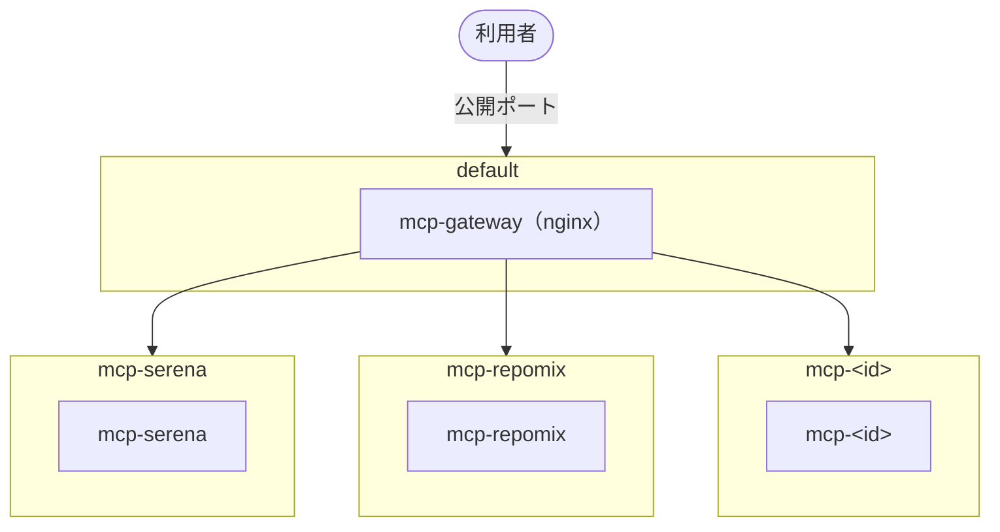

# docker-mcp-servers

普段使いの MCP サーバーを docker compose でホストするためのひな型構成です。

## 前提

- Docker
- Docker Compose v5.3.0 以上（`pre_start` を使うため）

## 使用方法

利用するプロジェクトに、以下をコピーします。

| 対象 | 内容 | コピー方法 |
| --- | --- | --- |
| `compose.yaml` | 必要なサービスとネットワークの定義 | 利用プロジェクトの compose.yaml に記述をコピー＆ペースト |
| `docker/mcp/gateway/` | gateway の Dockerfile と nginx 設定 | ディレクトリごとコピー |
| `docker/mcp/<id>/` | 利用する MCP サーバーのディレクトリ | ディレクトリごとコピー |

## 構成



MCP サーバーの一覧、ネットワーク、gateway などの詳細は [SPEC.md](SPEC.md) を参照してください。

## ディレクトリ構成

```text
.
├── compose.yaml          # MCP サーバーと gateway のサービス定義
├── docker/
│   └── mcp/
│       ├── gateway/      # gateway（nginx）の Dockerfile と設定
│       └── <id>/         # MCP サーバーごとのファイル
│           ├── README.md # MCP サーバーの主旨と使用方法
│           ├── SPEC.md   # MCP サーバー固有の仕様
│           └── Dockerfile # カスタムの Dockerfile（必要な場合）
├── scripts/              # Makefile から呼び出す補助スクリプト
├── README.md             # プロジェクトの主旨と概要（このファイル）
├── SPEC.md               # 共通の仕様
├── AGENTS.md             # コーディングエージェント向けの指示
├── CLAUDE.md             # Claude Code 向け（AGENTS.md を読み込む）
├── mise.toml             # 開発ツールとバージョンの定義
├── .env.example          # 環境変数の設定見本（.env にコピーして使う）
├── Makefile              # 作業用のタスク定義（一覧は `make` で表示）
├── .markdownlint.yaml    # Markdown lint の設定
└── LICENSE
```

## セキュリティ

- **方針**: イメージは公式イメージを優先し、版または digest で固定します。外部から受け付ける gateway はイメージの脆弱性を検査し、外部と通信できない MCP サーバーはネットワーク分離で守ります（イメージは検査しません）（[SPEC.md の方針](SPEC.md#方針)）
- **ネットワーク分離**: 各 MCP サーバーを専用の docker network に隔離し、MCP サーバー間の通信と、外部（インターネットを含む）への通信をできなくしています
- **読み取り専用マウント**: MCP サーバーに渡すプロジェクトのディレクトリは読み取り専用でマウントし、MCP サーバーからファイルを変更できないようにしています
- **公開範囲の限定**: gateway の公開ポートは `127.0.0.1` にのみ bind し、LAN には公開しません。gateway で公開するパスは MCP エンドポイントのみの許可リスト方式です
- **DNS rebinding 対策**: gateway で `Host` / `Origin` ヘッダーを検査し、ブラウザ経由の不正なリクエストを拒否します
- **gateway の脆弱性検査**: `make scan-mcp-nginx` で検査し、修正版がある High 以上の脆弱性があれば失敗させます（[SPEC.md の脆弱性検査](SPEC.md#脆弱性検査)）

詳細は [SPEC.md のセキュリティ](SPEC.md#セキュリティ) を参照してください。

## ドキュメント

- [SPEC.md](SPEC.md) — 共通の仕様
- [docker/mcp/serena/SPEC.md](docker/mcp/serena/SPEC.md) — serena の仕様
- [docker/mcp/repomix/SPEC.md](docker/mcp/repomix/SPEC.md) — repomix の仕様
- [AGENTS.md](AGENTS.md) — コーディングエージェント向けの指示

## ライセンス

このプロジェクトのライセンスは MIT です。詳細は [LICENSE](LICENSE) を参照してください。
