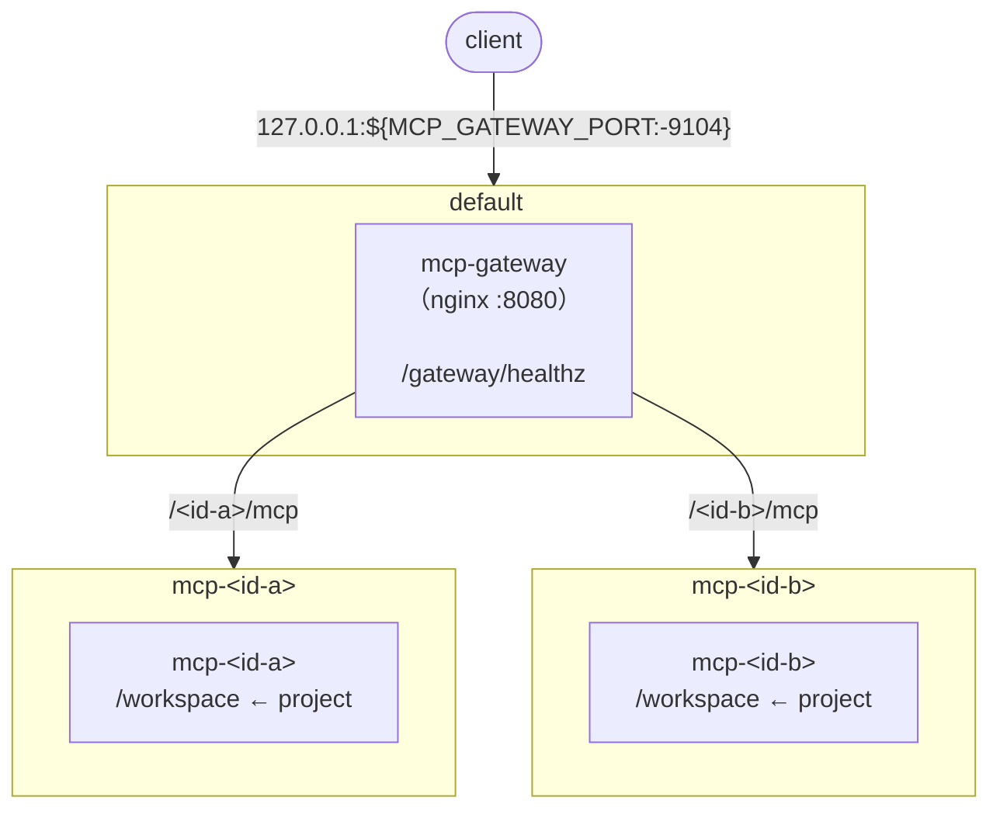

# docker-mcp-servers

普段使いの MCP サーバーを docker compose でホストするためのひな型構成。

## 構成図



- `mcp-gateway` は `default` と、すべての `mcp-<id>` ネットワークに所属する
- 各 MCP サーバーは、自身の `mcp-<id>` ネットワーク（internal）にのみ所属する

## ネットワーク

- ネットワーク名は `mcp-<id>`（`<id>` は MCP サーバーの識別子）
  - 例: GitHub MCP サーバー → `mcp-github`
- `mcp-<id>` は `internal: true` とし、外部と通信できないようにする（[ネットワーク分離](#ネットワーク分離) 参照）
- 起動前の準備（`pre_start`）で外部との通信が必要な場合は、そのステップにだけ `default` ネットワークを加える

## MCP サーバー

- docker compose のサービス名は `mcp-<id>` とする
  - ひな型として他プロジェクトの compose.yaml にコピーした際に、既存のサービス名と衝突しないようにするため

| 識別子 | 概要 | 仕様 |
| --- | --- | --- |
| serena | [Serena](https://github.com/oraios/serena) | [servers/serena/SPEC.md](servers/serena/SPEC.md) |
| repomix | [Repomix](https://github.com/yamadashy/repomix) | [servers/repomix/SPEC.md](servers/repomix/SPEC.md) |

### イメージ

- 公式イメージで完結できる場合は、公式イメージを使う
  - 完結できるとは、MCP サーバーに必要な実行環境とツールがイメージにそろっていて、実行時に外部から取得するものがないことをいう（`mcp-<id>` は外部と通信できないため）
- 完結できない場合は、カスタムの Dockerfile を作る
  - カスタムの Dockerfile では、MCP サーバー本体を `/opt/<id>` にインストールする
- 依存関係（ベースイメージ、MCP サーバー本体、依存パッケージ）はバージョンまたは digest で固定する
  - 公式イメージは digest で固定する
- npm のロックファイル（`package-lock.json`）を作るときは、次を行う（npm のレジストリは信用しきれないため）
  - `npm audit fix --package-lock-only --ignore-scripts` で、脆弱性のある依存パッケージを semver の範囲内で修正済みの版に上げる（`--force` は使わない）
  - `npm audit` で残った脆弱性を確認する
  - `npm ci --ignore-scripts` でインストールしたうえで、`npm audit signatures` で署名を検証する
- uv のロックファイル（`uv.lock`）を作るときは、次を行う
  - `uv audit --frozen` で脆弱性とプロジェクトの状態（PyPI での隔離など）を確認する（uv では実験的な機能）
  - 修正済みの版がある場合は、`uv lock --upgrade-package <名前>` で上げる（依存元の制約の範囲内）

### マウント先

- MCP サーバーが扱うプロジェクトは、コンテナ内の `/workspace` にマウントする
- `/workspace` はマウント専用とし、イメージ内では使用しない
  - 公式イメージを使用する場合は、イメージが `/workspace` を使用していないことを採用時に確認する

## gateway

- docker compose のサービス名は `mcp-gateway`
- gateway は nginx で構成する
  - nginx は Alpine の公式パッケージを使用し、[脆弱性検査](#脆弱性検査) に合格した最新版にバージョンを固定する
  - パッケージに含まれるファイルは変更しない（`apk audit` で不一致が出ないようにする）
- 外部からのアクセスは gateway コンテナを経由して各 MCP サーバーに配信する
- gateway は各 MCP サーバーが属するすべての `mcp-<id>` ネットワークに所属する
- 外部からの受付は default ネットワークで行い、gateway の公開ポート経由で利用させる
- nginx の listen ポートは `8080`
- 公開ポートのデフォルトは `9104` とし、環境変数 `MCP_GATEWAY_PORT` で上書きできるようにする
- 接続先
  - ホストからは `http://localhost:<port>/...` で接続する

### 脆弱性検査

- gateway のイメージは `make scan-mcp-nginx` で検査する
  - `make up` には組み込まない（検査の結果で普段のビルドを止めないため）
- High 以上（CVSS 7.0 以上）または深刻度不明の脆弱性のうち、修正版があるものがあれば失敗とする
  - 修正版がないものは警告として表示し、失敗にはしない
  - 修正版の有無を判定できないものは失敗とする
- 除外指定（osv-scanner の設定による無視）は行わない
- 次のときは、版を上げて検査し直す
  - 検査が失敗したとき
  - 固定した版がリポジトリから取得できず、ビルドが失敗したとき（固定は緩めない）

### パス規約

- 先頭のパス要素は識別子（MCP サーバーは `<id>`、gateway 自身は `gateway`）とする

| パス | 転送先 |
| --- | --- |
| `/<id>/mcp` | `http://mcp-<id>:<port>/<上流の MCP エンドポイント>` |
| `/gateway/healthz` | gateway 自身（ヘルスチェック） |

- MCP サーバーは `/<id>/mcp` で公開する
  - 上流の MCP エンドポイントのパスが異なる場合は、nginx で `/mcp` に読み替える
- 公開するのは MCP エンドポイントのみとする（許可リスト方式）
  - `location =`（完全一致）で定義し、前方一致で上流のパスを丸ごと転送しない
  - MCP 以外に公開が必要なものは `/<id>/<name>` で個別に追加する
- gateway 自身のパスは `/gateway/...` とする
  - サービス名 `mcp-gateway` と `mcp-<id>` は compose 内で一意なので、`/<id>/...` と衝突しない

### トランスポート

- gateway の後ろに置く MCP サーバーは、原則 Streamable HTTP で稼働させる
  - SSE トランスポートはメッセージ送信先のパスをサーバーが返すため、パスを付け替えると壊れる可能性がある

### nginx 設定

- 設定ファイルは MCP サーバーごとに分ける

```text
gateway/
├── Dockerfile
├── nginx.conf          # 共通設定
└── conf.d/
    └── <id>.conf       # MCP サーバーごとの設定
```

- すべての MCP エンドポイントの location に、SSE 応答に対応する設定を入れる
  - `proxy_http_version 1.1`
  - `proxy_buffering off`
- 上流は Docker 内蔵 DNS（`resolver 127.0.0.11`）と変数を使った `proxy_pass` で実行時に名前解決する
  - 一部の MCP サーバーが停止していても gateway が起動できるようにするため

## セキュリティ

### ネットワーク分離

- MCP サーバーとその依存パッケージの保護は、ネットワーク分離によってのみ行う
  - 依存パッケージの検査（ロックファイルやイメージの脆弱性検査）は行わない
  - 例外として、npm と uv のロックファイルを作るときの手順を定める（[イメージ](#イメージ) 参照）
- 各 MCP サーバーは個別の `mcp-<id>` ネットワークに隔離し、MCP サーバー間で通信できないようにする
- `mcp-<id>` は `internal: true` とし、MCP サーバーから外部（インターネットを含む）へ通信できないようにする（必須）
  - gateway は `mcp-<id>` に所属するため、gateway から MCP サーバーへの通信は届く
  - 依存パッケージに悪意のあるコードが含まれていても、情報の持ち出しや外部からの指示を受けることを防ぐ
- 例外として、`pre_start` で依存関係を取得するステップだけは `default` にも所属させ、外部と通信できるようにする
  - サービスの `mcp-<id>` は `pre_start` に引き継がれ、外せない（Compose の動作による）
  - 専用のネットワークを用意しても、サービスから使われないネットワークは Compose が作らないため、`default` を使う
  - `default` を使うのは gateway だけなので、MCP サーバーだけを起動するときにも定義されるよう、MCP サーバーは `depends_on` で gateway に依存させる

### 読み取り専用マウント

- MCP サーバーへのプロジェクトのマウントは読み取り専用（`:ro`）とし、MCP サーバーからプロジェクトのファイルを変更できないようにする
  - 例外として、起動前の `pre_start` でボリュームのマウント先を作るステップだけは書き込み可能でマウントする（コマンドは何もしない）

### 公開範囲

- gateway の公開ポートは `127.0.0.1` に bind し、LAN には公開しない
- gateway で公開するパスは許可リスト方式とする（[パス規約](#パス規約) 参照）

### DNS rebinding 対策

- gateway（nginx）で `Host` ヘッダーと `Origin` ヘッダーを検査し、許可しないリクエストには `403` を返す
- `Host` はホスト名のみを検査し、ポート番号は検査しない
  - 許可するホスト名: `localhost`、`127.0.0.1`、`host.docker.internal`
  - DNS rebinding で送られてくるのは攻撃者のホスト名であり、ポート番号の検査は防御に寄与しない
  - 公開ポートを変更しても nginx の設定変更が不要になる
- `Origin` は、ヘッダーがない場合は許可し、ある場合は `localhost` / `127.0.0.1` のみ許可する
  - ブラウザ以外の MCP クライアントは通常 `Origin` を付けない（推定）
